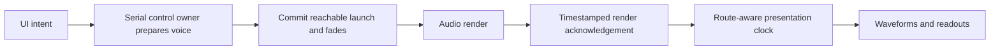

# Native audio architecture audit

3 November 2026 · reviewed commit `b5ee5da9ffbefda46cdab7f7a778c0761e904be1`

## Recommendation

Keep AVAudioEngine, Apple file playback/decoding, AVAudioUnitTimePitch, and the bounded C DSP as the starting implementation. Refactor the scheduling/presentation boundary and the master/cue render contract before treating the engine as performance-ready. A complete replacement of Apple’s engine or time-stretch implementation is not justified by this audit. The competitive research below makes retention of individual playback/DSP components conditional on measured DJ performance; it does not justify retaining them at any cost.

The recent changes contain useful engineering, especially the corrected gain order. The Bluetooth change addresses a real missing delay. However, the system still predicts playback before confirming that playback commands executed, and the distortion workaround relies on an implicit relationship between separate render paths. Those are architectural concerns rather than reasons to discard all the existing work.

This was an audit and plan only. No production source or existing tests were changed.

## Requirements and scope

- User’s Mac: M3 MacBook Pro, macOS 27.0.1.
- Reported Bluetooth device: Bose SoundLink Flex.
- Full DJ functionality over Bluetooth, including cues and scrubbing; Mac and iPad have equal priority.
- Reviewed native transport, custom Audio Units and C rendering, routing, latency calculation, lifecycle handling, buffer ownership, preparation budgets, UI timing, relevant tests, and both recent fix commits. Electron remains frozen.
- Local verification used macOS 27.0.1 and Xcode 27.1. The iPad and Bose were not acoustically tested. A muted live-output check is not an acoustic synchronization measurement.

Bluetooth support needs two separate promises: reliable operation/aligned presentation, and an honest response-time model. The software can schedule and display consistently but cannot remove time spent buffering inside an external speaker. Full functionality can be supported; wired-like scratch response cannot be promised through architecture alone. No Bose-specific latency number is assumed here.

## Findings, in priority order

### 1. High: the transport commits deadlines before the player executes them

**Confirmed by an isolated production-module probe.**

`NativeDeck.schedule()` calculates a launch time with 30 ms lookahead, or a replacement with 120 ms lookahead. It immediately changes the transport clock, enqueues fade envelopes, and marks the deck playing. `DeckVoice.schedule()` subsequently submits the actual player operation to the shared serial control queue. There is no acknowledgement that the command met its deadline and no late-start reconciliation.

The probe held that queue while continuing to render 16 blocks of 1,024 frames, representing about 341 ms of output time. The display advanced to **0.3113 seconds while the recorded output remained exactly silent**. Once the queue was released, the clock was still ahead of source playback. This deliberately injected stall is not a claim that a 341 ms stall occurs normally; it demonstrates that queue delay can permanently invalidate the prediction.

This matters for audible/visual alignment, deck synchronization, and crossfades: an outgoing voice can be faded before the replacement is available. The existing queued-playback tests drain the queue before rendering, so they do not cover a deadline missed while rendering continues.

**Required change:** make preparation and launch a transaction owned by the audio control layer. Confirm that an incoming voice is scheduled with enough remaining lead before committing its gate, outgoing fade, and clock segment. Detect missed deadlines; retain the outgoing audio and replan rather than silently continuing with stale times. Publish render progress and generation acknowledgements so the UI cannot mistake intended playback for rendered playback.

Locations: `native/Sources/DexAudio/NativeDeck.swift:608`, especially 643–759; `TransitionGate.swift:86`; `AudioControlExecutor.swift:43`; `native/Tests/DexAudioTests/AudioControlTests.swift:46`.

### 2. High architectural concern: the cue workaround has no timestamp contract

**Code-confirmed dependency; no current cue dropout reproduced.**

The isolator now copies its most recent block into `DexCueTap`. A separate source node consumes that copy. The router pulls the master first and assumes that doing so produced exactly the cue block it needs. The copy carries only a frame count, with no sample timestamp, graph generation, or representation of partially consumed ranges. A same-sized old block is indistinguishable from the correct block. A frame-count mismatch is silently converted to silence.

The implementation is bounded and avoids another filter calculation. It passed the existing cue tests and an additional check varying render sizes through 64, 128, 256, 480, 512, 960, and 1,024 frames, including exact-zero channel and master gains. That is positive evidence, but does not establish the implicit ordering across every device, graph reset, buffering effect, or pull failure. The relaxed atomic frame count also does not provide cross-thread ownership of the sample memory; this is a same-render-thread handoff, not a general lock-free audio queue.

The original fault’s explanation remains a hypothesis. The earlier graph used Apple’s documented one-to-many connection API; a blanket rule that stateful units cannot feed multiple destinations is not an AVAudioEngine rule. The recording described in the commit supports a real block-boundary fault, and the user heard the fix, but neither identifies exactly which component violated its render contract. Several changes landed together, including replacing the Apple sweep EQ, so that success does not isolate fan-out as the cause. [Apple’s fan-out API](https://developer.apple.com/documentation/avfaudio/avaudioengine/connect%28_%3Ato%3Afrombus%3Aformat%3A%29) explicitly supports multiple destinations.

**Required change:** give master and cue one explicit rendering owner with formal audio outputs. Use a correctly implemented custom AU with render-once timestamp caching, or a consolidated mixer render stage that derives both buses from the same input frames. Any shared cache must identify sample ranges and generations, handle the supported request sizes, and have a defined failure/reset policy. Preserve Apple’s limiter and other useful nodes. Do not simply restore the old connections and assume the fault is solved.

Locations: `native/Sources/DexAudio/MixerUnits.swift:38`, 60–66, 115–125; `native/Sources/CDexDSP/DexMixer.c:175`; `NativeMixer.swift:98`.

### 3. Medium: custom Audio Units do not implement reset semantics

**Confirmed by an isolated production-module probe.**

The custom isolator, transition gate, and router do not override `reset()`. Their C state is outside the superclass’s knowledge. Resetting the isolator after an impulse and then feeding silence left an output residual of **0.01366**, rather than clearing its filter history. There is also no explicit reset operation for cue waiting state, transition command queues, or router gain history.

This is a lifecycle contract gap, not proof that an audible glitch occurs on every seek. The shared tone section should remain continuous during a normal voice crossfade. Explicit graph discontinuities and reinitialization need a different, deliberate reset policy.

**Required change:** implement and test bounded DSP reset operations, preserve control targets, clear transient state, and invoke them at safe graph lifecycle boundaries. Do not clear active filters from an arbitrary UI callback while rendering. Apple documents reset as clearing filter/delay state at stream discontinuities. [AUAudioUnit reset contract](https://developer.apple.com/documentation/audiotoolbox/auaudiounit/reset%28%29).

Locations: `native/Sources/DexAudio/MixerUnits.swift`; `TransitionGate.swift`; `native/Sources/CDexDSP/DexMixer.c`, `DexRamp.c`.

### 4. Medium: the router hides upstream render failures

**Confirmed by an isolated production-module probe.**

`OutputRouterUnit.internalRenderBlock` converts every input status to a Boolean, replaces failed inputs with silence, and always returns `noErr`. A probe returning `-50` from every input pull received **0/success** from the router. Consequently the framework and application cannot distinguish successful rendering from a failed master path through this API. An independently successful cue pull can also consume a waiting copy after its producer failed.

**Required change:** define an explicit policy for master failure and optional cue failure. Safe silence can be appropriate, but preserve the error through the render result where appropriate and/or bounded atomic diagnostic counters. Notify/recover on the control plane; never log, allocate, or dispatch work inside the render callback. Test failure followed by recovery, with no stale cue replay.

Location: `native/Sources/DexAudio/MixerUnits.swift:119`.

### 5. Medium: Bluetooth compensation is useful but is not a complete presentation model

**Code-confirmed limitations; Bose/iPad behavior still needs physical measurement.**

The improvement is conceptually correct: separate rendering time from what the listener hears. However:

- The displayed position is still an intended host-time integration, corrected by one startup delay, rather than a timeline anchored to confirmed rendering. Finding 1 survives any constant latency subtraction.
- The macOS implementation reads device latency plus the **first** output stream’s latency, ignores several property-read failures, and defaults to zero. It does not report unknown/partial estimates. Selecting the first stream is insufficient as a general multistream-device policy.
- The comment that `presentationLatency` omits stream latency conflicts with Apple’s documented contract, which associates it with both device and stream latency. HAL access may be useful for a measured OS/device discrepancy, but that discrepancy should be captured and tested rather than treated as a universal framework deficiency. [Apple’s presentation-latency documentation](https://developer.apple.com/documentation/avfaudio/avaudioionode/presentationlatency).
- Device latency alone does not describe every processing path’s presentation time. The normal offline graph already reports about 2 ms downstream presentation latency at a player. Apple exposes downstream pipeline latency separately; player time, render time, and acoustic time must not be treated as interchangeable. [AVAudioNode output-presentation latency](https://developer.apple.com/documentation/avfaudio/avaudionode/outputpresentationlatency).
- The 750 ms clamp is chosen to fit a one-second transport-history assumption. Longer or unknown routes are silently represented by a smaller delay. History retention should follow the supported route budget and expose an unsupported/unknown state.
- While normal playback is delayed visually, jog position follows immediate gesture motion. Hot-cue recall is quantized in render time. Those may be sensible interaction choices, but they are separate timing policies and do not establish that every visualization follows Bluetooth audio.
- Pausing immediately freezes/resets the displayed clock; there is no explicit presentation-draining state for audio already queued downstream. The current tests assert the desired display freeze without measuring a physical output tail.
- The UI samples on a task sleeping 33 ms, independently of display refresh. This is acceptable for an initial 30 Hz view, but is not evidence of tight audiovisual timing under UI load.

**Required change:** introduce a route-aware presentation service with a defined reference point, graph generation, measured/reported delay components, estimate validity, and sufficient history. Read system properties on the control plane. Refresh on relevant route/latency changes; avoid querying HAL on every UI frame. Account for graph processing once, without blindly adding safety offsets or buffers already represented by host timestamps. A measured per-route calibration can correct a stable residual; it must not conceal clock errors or variable latency.

Define the earliest audible execution time of each command. For an input at host time `t`, a rendering change with preparation `P` and downstream delay `L` cannot be promised before approximately `t + P + L`. Quantized commands should choose a reachable future audible beat. Gesture feedback can be immediate while an independently tracked playhead follows presentation. Validate pause, seek, stop/restart, and draining behavior explicitly.

Locations: `native/Sources/DexAudio/OutputLatency.swift`; `NativeDeck.swift:38`, 290, 325, 650, 764; `NativeMixer.swift:193`; `native/Sources/DexApp/ConsoleModel.swift:201`.

### 6. Medium: configuration changes can be discarded during startup

**Code-level race risk, not reproduced in this audit.**

`installObservers()` drops configuration changes whenever `startTask` exists, and briefly after startup while the engine is running. Startup completion then publishes ready state without revalidating a configuration generation or confirming continuing render progress. This suppresses startup noise but can also suppress a real device change in that window. Apple documents that a hardware format change can stop the engine. [Configuration-change notification](https://developer.apple.com/documentation/avfaudio/avaudioengineconfigurationchangenotification).

**Required change:** coalesce events with a dirty flag/configuration generation instead of discarding them. After activation, validate the current route, formats, latency, and generation before publishing ready. Preserve the existing policy that a route loss does not unexpectedly resume on speakers.

Location: `native/Sources/DexAudio/NativeMixer.swift:125` and 185–194.

## What is already worth keeping

| Area | Assessment |
| --- | --- |
| AVAudioEngine and Apple playback nodes | Appropriate foundation for this scope. No evidence requires replacing hardware I/O, native decoding, or file scheduling. |
| AVAudioUnitTimePitch | Existing audio measurements pass for pitch and beat period across 84–116%. Keep it unless product-specific listening/performance tests demonstrate a limitation. Its player timing still needs careful mapping to output timing. |
| Gain staging | Moving master volume before the Apple limiter is sound. A limiter should handle overload rather than continuously reshape an otherwise attenuated signal. Existing render tests verify this improvement. |
| Flat EQ path and sweep smoothing | Exact flat passthrough and smoothed controls are useful. The custom LR4 isolator is not interchangeable with a generic three-band tone EQ. Keeping specialized DSP is a reasonable use of Apple’s AU hosting facilities. |
| Real-time DSP | Fixed scratch buffers, bounded command queues, C rendering, and atomic controls are good foundations. No render-loop allocation or file read was found in the reviewed C paths. |
| Audio ownership | Retained loop leases and acknowledged jog-cache retirement address real lifetime risks. Keep these mechanisms. |
| Preparation memory | Streaming analysis, compact waveform pyramids, 32 MiB retained-loop caps, three-window jog limits, and a shared 128 MiB preparation budget are sensible. This budget is not total process memory. |
| Control queue | Moving blocking framework calls away from UI/render callbacks is correct. It needs deadline-aware transactions, not removal. Audit the remaining main-actor graph construction/reset calls as part of consolidating ownership. |

There is no evidence here that moving more processing into Swift, using an Apple EQ for every filter, or moving down to raw Audio Units for the entire engine would improve reliability. Those changes increase the amount to validate. Use Accelerate selectively after profiling identifies a worthwhile hot path.

The meter uses a lock in a tap callback. That is not proof the primary render thread blocks, because taps may be delivered on a separate framework thread. A bounded atomic reading is still a cleaner handoff. More important performance questions—release-build render-time tails, time-pitch cost, battery/thermal behavior, conversion at 44.1/48 kHz—remain unmeasured.

## Verification results

| Check | Result and limit |
| --- | --- |
| Existing Swift suite | 55 core + 21 console + 123 audio tests discovered: 195 passed, 4 optional tests skipped, 0 failures. |
| Mac and iPad Simulator builds | Both succeeded with signing disabled; universal arm64/x86_64 app binaries produced. An inconsistent initial iPad compiler diagnostic was resolved by an incremental build with a structured result: succeeded, zero errors. Existing warnings include the generic HAL pointer helper and an unrelated console Sendable type. |
| Optional muted live clock | Passed gate handover and jog resumption on the current default output. Reported delay was 15.83 ms. This does not identify/validate the Bose or measure acoustic alignment. |
| 100-cycle endurance, default fixture | Failed with 26 out-of-bounds-loop assertions. The default track is only four seconds; the test repeatedly asks for loops beyond its end. This is a test-fixture/expectation defect, not evidence of a memory leak. |
| 100-cycle endurance, 60-second synthetic fixture | Passed. Sampled physical footprint: 17.89, 18.16, 17.42, 17.59, 17.69 MiB. A short offline test-process result, not the full app’s memory ceiling or a multi-hour device soak. |
| Blocked scheduling probe | Confirmed clock advance during completely silent output. |
| AU reset probe | Confirmed retained filter history after reset. |
| Router failure probe | Confirmed input errors converted to success. |
| Cue variable-quantum probe | No silent cue blocks in 169 observed blocks after warm-up; also passed exact-zero fader/master checks. No physical four-channel-device acceptance implied. |

Initial sandboxed audio attempts could not register Audio Units and one XCTest process aborted in Swift concurrency error handling. The same existing suite passed with Core Audio access. Those restricted-environment failures are not counted as product regressions.

Local evidence is retained under `out/audio-audit/`, including raw logs and a standalone Swift probe linked against the unchanged production modules. Non-unity-rate DC-ramp estimates were explored and excluded from conclusions: time-stretch signal processing makes that an unsuitable absolute-position measurement.

No multi-hour profiling, acoustic Bose test, physical split/USB cue check, or iPad runtime acceptance was performed. Existing CI’s iPad build is compile coverage, not an audio-device test.

## Implementation plan

### Phase 1 — establish executable contracts

Turn the confirmed probes into regression tests. Correct the endurance fixture. Add timestamped render-failure counters and launch/deadline diagnostics, readable outside the audio callback. Capture graph topology, sample rate, route identity, reported latency components, and SDK/OS version in test reports. Keep recordings local.

Acceptance: tests fail against the current scheduling/reset/error behavior for the intended reason, distinguish unknown latency from zero, and preserve current audible behavior in the passing tests.

### Phase 2 — consolidate control and timing ownership

Introduce one control owner for graph lifecycle and player preparation. Model each launch with its generation, source anchor, effective output timestamp, preparation readiness, and cancellation state. Commit playback/fades/clock as a consistent transaction. Add a render-progress snapshot with host/sample anchors and acknowledged generation. Keep UI observation on the main actor, with display-refresh-driven presentation sampling.

Acceptance: artificial control delays of 10, 30, 120, and 350 ms cannot falsely advance audible position or fade away valid outgoing audio; rapid supersession, interruption, and restart leave only the latest valid generation active. Verify actual rendered attacks against the presentation timeline, not just one deck against another.

### Phase 3 — formalize master/cue rendering and AU lifecycle

Replace the unversioned last-block handoff with explicit render ownership/sample-range identity. Prototype the shared AU render cache/formal output design before changing the production graph. Preserve the master Apple limiter and measured gain law. Implement reset, format/resource validation, bounded scratch ownership, and error handling for all custom units.

Acceptance: each source range is processed once, master/cue contain the correct ranges at every supported quantum, failed pulls never replay stale cue data, and reset/reallocation leaves no prior track/graph state. Test startup, silence, full mute, both decks, automation, and errors. Use repeated real-app launches to investigate the original distortion fault; an offline connection-count assertion is insufficient.

### Phase 4 — make Bluetooth and route recovery first-class

Build the shared presentation service with macOS HAL and iPadOS AVAudioSession adapters. Validate Apple’s documented latency APIs against actual routes; retain direct HAL calculation only where evidence warrants it. Coalesce configuration changes by generation. Specify quantized command deadlines, presentation draining, and jog feedback. Add optional per-route calibration only for measured stable residuals.

Acceptance: connect/disconnect/reconnect Bose, built-in/wired/USB changes, sleep/wake, iPad interruptions/media reset/background lock, and rapid changes during startup recover consistently without unwanted playback. Measure waveform alignment acoustically on both platforms, including tempo changes, seeks, cue recalls, short loops, and jog release.

### Phase 5 — profile and certify the supported matrix

Use release builds and Instruments on the M3 Mac and primary iPad, with two decks/time-pitch active, maximum retained loops, repeated jog reads, EQ/filter movement, and library analysis. Measure render-duration percentiles/maxima versus the actual buffer deadline, overload counts, CPU, physical footprint, allocations, and thermal behavior. Separate optional analysis admission from active playback guarantees. Measure idle power and suspend unnecessary rendering when safe.

Proposed gates to agree before implementation closeout: no missed render deadlines during a representative multi-hour set; no continuing memory growth after warm-up; existing offline beat-phase tolerances retained; measured audiovisual error within one display frame plus the route’s measured jitter; all scheduling deadlines either met or explicitly replanned; no stale audio after reset/recovery. These are targets, not current guarantees. A variable-latency route must report its limits rather than silently claim a tight bound.

Proceed in that order. Replacing the entire engine becomes a fallback only if a minimal, instrumented implementation demonstrates an Apple component cannot meet an agreed acceptance gate. Keep the same recorded-audio tests around any replacement so a rewrite cannot silently change transport semantics.

## Follow-up: comparison with established DJ software

Public-source research, 3 November 2026. The conclusion is to follow the established rendering and routing model more explicitly. Dex has a conventional signal path, but the predicted clock, implicit cue handoff, and automatic stereo/split switching should not become permanent architectural conventions.

### What the evidence establishes

Mixxx supplies an inspectable implementation rather than marketing claims. Its developer guide describes audio callbacks producing the next mixed buffer, with blocking work kept away from that path. Its current C++ mixer maintains separate main/headphone buffers, and its deck engine updates source position from frames actually processed. Those are useful reference designs; they are not evidence of proprietary competitors’ internals. [Mixxx engine guide](https://github.com/mixxxdj/mixxx/wiki/Developer-Guide-Engine), [mixer source](https://github.com/mixxxdj/mixxx/blob/main/src/engine/enginemixer.cpp), [deck source](https://github.com/mixxxdj/mixxx/blob/main/src/engine/enginebuffer.cpp).

Commercial products do not necessarily implement their DSP with Apple’s built-in effects. In a supplier interview, Algoriddim confirms licensing zplane time-stretching and analysis technology. That establishes component reuse, not djay’s complete internal graph or choice of I/O API. [Algoriddim/zplane interview](https://products.zplane.de/blog/karim-morsy-interview-algoriddim).

There is also an existing purpose-built SDK model: Superpowered documents a real-time player whose internal queued operations are applied during processing, with cached seek positions and a synchronized-launch method that does not advance its position before playback starts. This is a candidate benchmark, not a recommendation to purchase it or a claim that djay uses it. [AdvancedAudioPlayer documentation](https://docs.superpowered.com/reference/latest/advanced-audio-player/).

Apple itself supports advanced real-time processing, custom effects, file/buffer playback, and mixing through AVAudioEngine. Therefore the choice of that host is compatible with the required architecture; its presence alone neither proves nor disproves professional DJ reliability. [Apple audio-engine overview](https://developer.apple.com/documentation/AVFAudio/audio-engine).

### Comparison and resulting decisions

| Concern | Dex assessment | Direction |
| --- | --- | --- |
| Deck audio → tone section → program/cue buses → output channels | Broadly conventional. | Keep this signal model. |
| Timing authority | Rendering is real-time, but intended host-time playback can advance before queued player execution. | Rendered sample progress must be authoritative; commands need preparation and confirmed effective times. |
| Cue audio ownership | Uses a latest-block side handoff between separately pulled paths. | Give both buses explicit ownership of identified sample ranges. Copying audio is normal; relying on an unidentified most-recent copy is the concern. |
| Split output | Changes from stereo master to mono master/cue according to whether a deck is on CUE. | Separate stereo playback mode from fixed split-cable mode. Keep physical channel meaning stable. |
| Playback/DSP choice | Apple nodes plus custom DSP; currently no comparative DJ quality/response benchmark. | Keep useful components provisionally; compare before investing in a larger custom deck rewrite. |
| Bluetooth versus wired monitoring | Currently shares the same routing concept and a single delay adjustment. | Maintain explicit route capabilities and separate playback/alignment gates from independent headphone-monitoring gates. |

### A concrete split-output departure

Algoriddim documents DJ split output as one mono master side and one mono cue side; it explicitly says the speaker feed is always mono with that cable. [djay pre-cueing documentation](https://www.algoriddim.com/hardware/precueing).

Dex’s `dex_router_process()` instead makes that fold conditional on a selected deck CUE. With an actual split cable and no deck CUE, the speaker side receives only the original master-left signal. Pressing CUE changes it into the left/right mono sum. Thus the audience’s stereo content/downmix changes when a headphone selection changes. This follows a previously agreed product decision, so no behavior was changed during this audit. The comparison provides a concrete reason to revisit it.

Recommended modes: ordinary stereo playback; fixed mono-master/mono-cue split output; and stereo master plus stereo cue on a suitable multichannel interface. CUE selection should affect the cue mix without changing the audience channel’s assignment or downmix. Bluetooth playback should use the stereo mode, rather than disguising a stereo output as a split cable.

### Bluetooth is not the same demonstrated capability

djay’s current iPad manual excludes pre-cueing when using Bluetooth/AirPlay. Native Instruments separately warns that Bluetooth latency makes real-time Traktor cueing unsuitable, while allowing playback-only use. These documented limits do not prove no app/device combination can offer more; they do show that reliable wired split cue is not evidence that independent Bluetooth master/cue routing is solved on the same setup. [djay audio manual](https://help.algoriddim.com/user-manual/djay-ios/getting-started/audio), [Native Instruments Bluetooth guidance](https://support.native-instruments.com/support/solutions/articles/69000880004-notes-on-using-bluetooth-speakers-headphones-with-ni-products).

The user’s Bose playback/aligned-waveform requirement remains valid. Treat simultaneous independent headphone monitoring through another route as an additional, platform-specific capability to establish rather than an implication of Bluetooth playback support.

### Refinement to the implementation plan

Before a substantial custom transport rewrite, build a narrow comparison around prepared cue recalls, short loops, scrub/release, tempo changes, source-to-output timing, two-deck CPU, and memory. Compare Dex against djay on the same Mac/iPad and the same supported physical output configuration. Separately prototype an established DJ SDK if the existing Apple player/time-pitch combination cannot meet those gates without growing scheduling complexity. This is a component decision: the UI, library, analysis data, and Apple platform integration can survive a deck-engine replacement.

Follow established ownership/timing/routing principles now. Choose individual algorithms and APIs by measured results. Do not assume either that all commercial apps use AVAudioEngine, or that building a bespoke low-level engine automatically reproduces their maturity.
